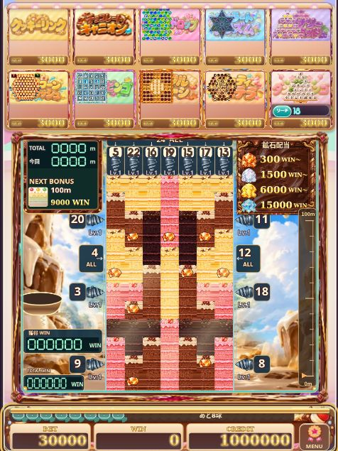
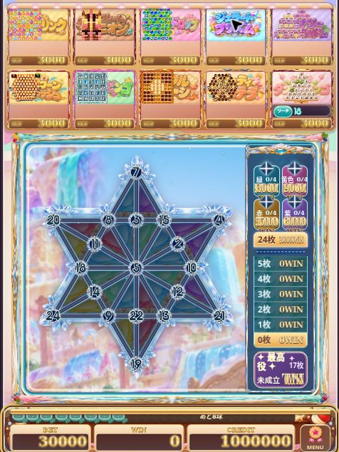

# v276 — 盤面の比較調整・HIT演出・ルーレットの動き

Version: `20261120-v276-hit-and-roulette-polish-r2`
Base: `6e820baba805ea41c2875e277fbab7de81131a04`（v275）

## 目的と進捗

ユーザーが選んだ「各ゲームを見比べて微調整する」方針に沿い、キャニオンの上下のつながり、盤面ごとのHIT演出、ジェラートの配当表示を整えた。また、発射ごとの軌道の幅を増やし、三角ストッパーに接触した球が周回速度を保ちながら外向きへ抜け、既HIT穴の上でも停滞しにくい物理形状へ調整した。

**公開・最終確認済み。** 実装の最終コミットは `40b912f0bc33b614ea8ecec23d54adcc137eef46`。その後は検査の撮影方法だけを更新し、`16b7769b64294f59d41dd0efe87d0ff499d61b26` で全10ゲームの実HIT・ミニ盤面・動きを減らす設定・配当枠のブラウザーCIが成功した。公開先の主要9ファイルもローカルの最新版とSHA-256が一致した。Windows実機へのソース反映・再起動は別途必要。

## キャニオンの上下オートタイル

v275の新しいケーキは上面のクリームが高さ約45%まであるが、旧サンプラーは34%から本体を読んでいた。そのため、上下につながるマスの内部にも上面が残っていた。接続部分を広い単色帯へ伸ばす処理と、T/L字で上下の側面参照が異なる処理も修正した。

新素材のスポンジ本体を50～94%の範囲から参照し、上下の接続には画像の模様を幅全体から使う。露出した上端には元のクリームと飾りを残す。斜めの隣接も参照するため、T/L字や内角でも同じ接続端になる。フルーツのグレーズも上下でなじませた。47種類のマスク、6種類の表面差、宝石素材、キャッシュ、融解・落下の処理は維持する。

実際の生成PNGと本番描画関数による検査では、通常4素材＋フルーツについて周囲1024配置ずつ、**上下5120組の接続端のRGBA差が0**。通常4素材の左右の接続端も差0。角の検査、282個の既存宝石スプライト、入力画像不変も確認した。詳細は [canyon-autotile-v276.md](canyon-autotile-v276.md)。

## 全10ゲームのHIT演出

`assets/hit-presentation-v276.js` と同CSSが、各エンジンの実イベントを受けてHIT位置へ演出を重ねる。ゲームごとの元のアニメーションに合わせて、同時HIT、連鎖、反転、流入、ライン成立のタイミングを追う。

| ゲーム | 加えた演出とタイミング |
|---|---|
| クッキーリンク | HIT位置からクッキー片と光粒。LINKが深くなるほど強い光を付ける |
| チョコレートキャニオン | 掘削・融解・パワー効果の場所にケーキ片と暖色の光 |
| シックスドロップ | HITと役成立に、宝石状の輪郭光とドロップ片 |
| ジェラートプリズム | 交点HITと三角面の成立に、氷色の結晶光 |
| ワイナリーピラミッド | 注入口とグラスの配当成立に、紫の波紋と泡 |
| ポップコーンスプラッシュ | 入賞口から実際の連鎖順に、粒と弾ける光 |
| ジェリービンゴ | HITしたマス、仕切りの解除、色の流入に、水色の波紋と泡 |
| ワッフルリバーシ | 置いた場所から反転順に、角丸の光と駒の軌跡 |
| パーティカステラ | 注入口・焼成の起点から広がる順に、カステラ片と暖色の光 |
| ダンゴデビンゴ | HITした団子と成立ラインに、桃色の花びら・団子片・光の軌跡 |

数字や素材の中央は輪郭光で空ける。非選択ゲームのミニ盤面にも簡略化した演出を出し、表示倍率や元の座標から位置を求める。演出は1ゲームあたり待機24個まで、同時表示はメイン8個・ミニ4個、粒数はそれぞれ最大96個・16個に制限する。ミニ盤面は最大約30fpsで更新する。

「動きを減らす」が有効なら飛び散りを省き、300msの短い輪郭表示にする。非表示・一時停止・BET前には新たなHITを出さず、保存データの復元やFREE配置の再描画でもHITを再演しない。精算・ダウンロード計算用workerでは演出を起動しない。各エンジンの元のイベントを1回だけ通し、演出の乱れ方にはゲーム用RNGを使わない。

## ジェラートの配当表示

配当数字の高さを保ち、桁数が多い場合だけ実際の表示枠に合わせて横方向へ縮小する。色別コレクター、通常配当、24枚配当、最高役のそれぞれの枠で幅を測る。フォント読込完了とサイズ変更でも測り直す。横縮小する文字をflex内で中央・右端に揃え、縮小前の文字幅による右ずれも修正した。行の構成、ラベル、配当式は変えない。ブラウザーCIではPCのBET3000、スマートフォン幅390pxのBET300000について、各29ラベルが自分の枠内に収まることを確認した。

## 発射と三角ストッパー

本番の `PHYSICS` を更新した。同じコードをストリーミングの物理ホストと、サーバー側のダウンロード録画計算が使う。

- 発射速度、角度、回転量、発射口内の微小な位置、床からの間隔、内向き・上向き成分、縦軸回転にシード付きの幅を持たせた。速度幅は基準8.82に対して±0.62、角度は±約4.7°、回転量は基準の0.85～1.15。各球で一度だけ決め、待機や録画の都合で引き直さない。
- 三角ストッパー3個の120°間隔、平面寸法、角丸、向きは維持する。中心を0.07モデル単位だけ内側へ寄せ、外側へ下がる上面の傾きを45°から約25.2°へ調整。球が入る側を滑らかに面取りする。見た目と当たり判定は同じメッシュから作る。
- 専用の反発係数を0.68、摩擦を0.008に調整。同じ三角メッシュの複数面が1つの接触に重複して減速を掛けることを防ぐ。床、穴、球同士の接触は従来のまま。

120Hzの実Cannon検査では、通常のかすめる接触6条件で、離れた後の速度が接触直前の**74.4～91.8%**となり、全3方向で外向きの速度を持って抜けた。同条件の旧版参考値は約38%・50%。既HIT穴上の球は、盤と一緒に動く状態と初速0・隣接穴も塞がれた状態を全3方向で検査し、6条件とも1.70～1.90秒で実際の空き穴へ入賞した。2シードの本番8球録画も、異なる8番号・fault0で完走した。

追加の力、瞬間移動、番号選択による補助はない。**必ず隣接する次の番号へ入れる仕様ではなく**、接触後の球は物理的に到達した空き穴へ入る。正面・低速・先端接触など、すべての衝突で同じ速度維持率を保証するものでもない。詳細と条件別の数値は [roulette-motion-v276.md](roulette-motion-v276.md) と [roulette-motion-v276-qa.json](roulette-motion-v276-qa.json)。

## 維持した内容と適用範囲

元の背景、v275の5枚の生成PNG、v274の盤面・配当枠を維持する。盤面の装飾修正は数字・配置・BET・配当式・保存形式を変更しない。シュガーチャレンジの条件、JP額横の「×n」、はずれ配当への倍率非適用も維持する。JPC突入率9.949938%は、既存の一様非復元8/25モデルでの理論値である。

物理変更によって球の軌道と入賞列は変わる。今回の検査は接触・再現性・完走を対象とし、25番号の長期的一様性や、ゲーム全体の実測ペイアウト率を再較正したものではない。

公開ページの更新に加え、**物理抽選・録画計算を行うWindowsサーバーは最新ソースへの更新と再起動が必要**。ユーザーの `.runtime`・`.tools`・`data` は保持し、最新mainのソースを反映して既存の `start-shared-machine-tunnel.cmd` から起動する。ランチャーの起動だけではソース更新にならない。ホスト画面と参加端末も再読み込みする。既に確定済みの録画は保存された位置・時刻を再生するため、過去の軌道や入賞は変更されない。クライアント側で新たに8球を抽選する経路は追加していない。

## 確認コマンド

```bash
npm run check
npm run test:payout
npm run test:sugar
node tests/hit-presentation-v276.mjs
node tests/canyon-autotile-v276.mjs
node tests/roulette-motion-v276.mjs
node tests/download-v255-recording.mjs
node tests/download-v255-cache.mjs
```

キャニオン検査だけはQA専用の `@napi-rs/canvas@0.1.100` を使う。本番ページの依存には追加しない。HIT検査はイベントの1回転送、状態・RNG不変、実座標、重複・復元の抑制、ミニ盤面、動きを減らす設定、粒数上限を確認する。物理検査と録画検査は本番Cannonの同じソースを使う。

`tests/game-polish-v276-browser.mjs` はCI専用で、隔離したローカル版と仮CREDIT・番号指定を使い、全10ゲームの実エンジンから出たHIT、ミニ盤面、復元、配当の収まりを確認する。公開サーバーへのAPI・外部リクエストを遮断する。短い演出を撮り逃さないよう、入力前から実フレームを監視し、描画されたcanvasをその場でPNGとして保存する。撮影のために本番の演出時間やゲーム状態を変更しない。

## 最終結果と確認画像

| 確認 | 結果・記録 |
|---|---|
| 全10ゲームの実HIT・mini・動きを減らす設定 | [Game HIT and roulette polish v276](https://github.com/naokingu123-cloud/cookie-link/actions/runs/44698770588) 成功。メイン10件＋静かな表示1件、非選択mini1件で実描画を確認。page/API/external errorsは0 |
| 物理・録画・上下接続・イベント不変・キャッシュ | 同CIの `motion-and-autotiles` 成功。録画は同一シードの全フレーム一致と実際の8個の異なる入賞を確認 |
| 全10ゲームの画像・枠・背景・配当ルール | [Illustrated game cells v275](https://github.com/naokingu123-cloud/cookie-link/actions/runs/44697358302) の2ジョブ成功。最終runtimeと同じソース |
| 公開 | [Pages deployment](https://github.com/naokingu123-cloud/cookie-link/actions/runs/44698770106) 成功。主要9ファイルの配信SHA-256一致、公開版のCanyon/Gelatoを目視確認 |
| 長い配当 | PC BET3000と幅390px BET300000で各29ラベルが枠内。公開版でも29ラベルのはみ出し0 |
| 静かなHIT表示 | Dangoの300ms輪郭を実フレームで確認。メイン・miniとも動く粒0、終了後にcanvas非表示 |

まとめは [verification.json](qa-v276/verification.json)、実測は [browser-report.json](qa-v276/browser-report.json)、[ci-roulette-motion.json](qa-v276/ci-roulette-motion.json)、[canyon-autotile.json](qa-v276/canyon-autotile.json)。全画面PNG13枚はActions artifactへ出力し、12枚の実HITビットマップは `qa-v276/hit-*-overlay.png` として保持した。数字の中央を空けた円・結晶輪郭・波紋・角丸枠を確認している。

公開版の確認画像：





クラウドの確認ブラウザーでは3D抽選機の読込エラーが出たため、公開画面はローカル版の番号指定で確認した。接触・押し出し・完走は本番Cannon/PHYSICSによる計算で検証し、Windows実機の映像確認や既存サーバーの更新・再起動は行っていない。

既存の `Six station check` と `Shared machine check` には、全体の版番号と変更のないモジュールの固定URL版番号を同一とみなすチェックの失敗が残る。開始時点のv275でも同じassertionが失敗し、関連10ファイルは今回未変更。証拠は [legacy-version-gates.json](qa-v276/legacy-version-gates.json)。このため、リポジトリー内の全workflow成功とは表現しない。
